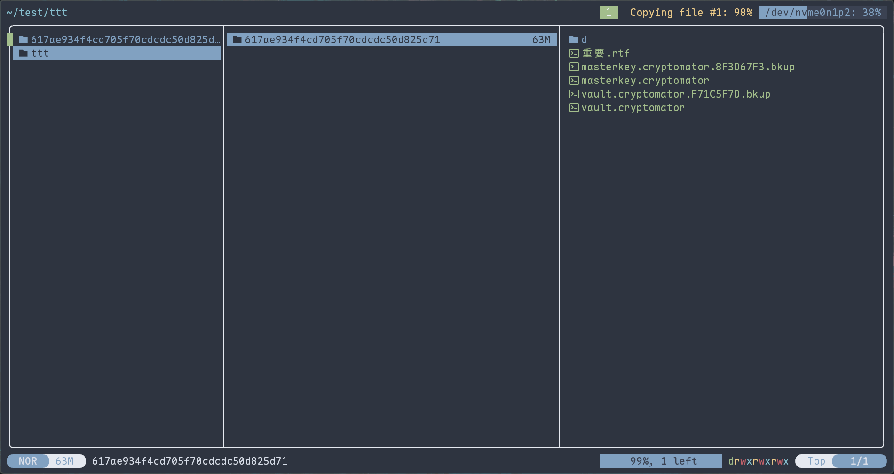

[English](README.md) | [中文](README.zh-CN.md)

# rsync-paste 插件

一个 Yazi 文件管理器插件，使用 rsync 进行高效的文件复制/移动操作，特别适合跨磁盘操作。

## 功能特性

- 🚀 使用 rsync 进行文件复制/移动操作，比常规方法更高效
- 💽 支持跨磁盘操作
- 📊 在 Yazi 的 header 区域实时显示操作进度
- 📦 支持批量操作
- 🔔 操作完成后显示通知结果

## 安装方法

### 方法1：使用 ya 包管理器

```bash
ya pkg add WayneKent/rsync-paste
```

### 方法2：手动安装

1. 从 GitHub 克隆仓库：
    ```bash
    git clone https://github.com/WayneKent/rsync-paste.yazi.git
    ```
2. 将插件复制到 Yazi 插件目录：
    ```bash
    cp -r rsync-paste.yazi ~/.config/yazi/plugins/
    ```
3. 确保系统已安装 `rsync` 命令（大多数 Linux 系统默认已安装）

## 使用方法

1. 在 Yazi 中选择要复制/移动的文件或目录（使用空格键选择）
2. 使用 `y` 命令复制或 `x` 命令剪切
3. 导航到目标目录
4. 使用 `'` 命令粘贴

### 必须配置键位映射

在 `~/.config/yazi/keymap.toml` 中添加以下配置之一：

```toml
[mgr]
prepend_keymap = [
{ on = ["'"], run = "plugin rsync-paste", desc = "Paste yanked files with rsync" },
]
```

或

```toml
[[mgr.prepend_keymap]]
on = "."
run = "plugin rsync-paste"
desc = "Paste yanked files with rsync"
```

## 效果预览



## 技术细节

- 使用 rsync 的 `-a` 参数保留文件属性和显示进度
- 对于移动操作，会先复制文件然后删除源文件
- 进度信息会实时显示在 Yazi 顶部状态栏

## 常见问题

**Q: 为什么选择 rsync 而不是系统自带的复制命令？**  
A: rsync 在跨磁盘操作和大文件传输时更高效，且能提供更好的进度反馈。

**Q: 如何知道操作是否完成？**  
A: 操作完成后会显示系统通知，并在状态栏显示最终结果。

## 许可证

本项目采用 [MIT 许可证](LICENSE) 开源。

## 致谢

- 感谢 Yazi 项目提供的优秀文件管理器
- 感谢 rsync 开发团队
